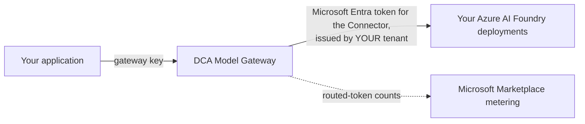

# DCA Model Gateway

One OpenAI- and Anthropic-compatible endpoint in front of the Azure AI Foundry deployments **you already run in your own
Azure subscription**. DCA Model Gateway is a Microsoft Marketplace SaaS offer from Derek Coleman & Associates Inc.

- **Your Foundry, your bill.** Every request runs on your own deployment. Microsoft bills the model usage to your Azure
  subscription; the gateway never resells model access.
- **Keyless connection.** The gateway signs in to your Microsoft Entra tenant as the *DCA Model Gateway Connector* and can
  use only the Azure role you grant it. No Foundry keys are shared or stored.
- **Routes instead of model names.** Send `x-dca-route: cheap`, `oss-only`, `auto`, `reasoning`, `code` or `frontier` and the
  gateway uses the deployment you mapped to that route.
- **Data boundary per request.** `x-dca-data-boundary: us` restricts a request to the deployments you declared as United
  States data zone deployments. Anything else is refused, never rerouted.
- **Token budgets.** Each gateway key has a per-minute token rate and a monthly token cap, and every response reports what is left.
- **Metered on your Azure invoice.** Routed tokens are counted per million, by model tier, through Microsoft Marketplace.
- **No content stored.** The gateway records token counts, routes and deployment names. It never stores prompts or responses.

## How it works



1. Your application calls the gateway with its gateway key.
2. The gateway checks the key, the token budget, the route and the data boundary.
3. It obtains a Microsoft Entra token for the DCA Model Gateway Connector from your tenant and forwards the request to your deployment.
4. It returns your deployment's answer, plus headers that show which deployment served it and how much budget is left.

## Quick start

1. **Subscribe.** Open [DCA Model Gateway on Microsoft Marketplace](https://azuremarketplace.microsoft.com/en-us/marketplace/apps/dcassociatesgroupinc.dca-model-gateway?tab=Overview),
   choose a plan, then select **Configure account now**. Sign in with your work account and activate the subscription. If its
   status shows *Pending activation*, our team confirms it before billing starts, and you can do step 2 meanwhile.
2. **Connect your Foundry.** Add the connector to your tenant and give it a data-only role on your Foundry resource. In
   Azure Cloud Shell, signed in to the subscription that holds the resource:

   ```bash
   git clone https://github.com/Derek-Coleman-Associates-Corporation/dca-model-gateway
   bash dca-model-gateway/samples/connect/connect-foundry.sh <resource-group> <foundry-resource-name>
   ```

   Then go to [saas.dcassociatesgroup.com](https://saas.dcassociatesgroup.com), open **Subscriptions**, open the subscription's
   menu and choose **Connect your Foundry**. Enter your endpoint and at least a default deployment, and select **Save and test**.
   Details: [Connect your Foundry](docs/connect-your-foundry.md).
3. **Get your key.** In the same menu, choose **Regenerate gateway key**. The key is shown once, so store it in your secret manager.
4. **Call the gateway.**

   ```bash
   curl https://ai-gateway-east-us1.azure-api.net/gateway/openai/v1/chat/completions \
     -H "api-key: $DCA_GATEWAY_KEY" -H "Content-Type: application/json" \
     -d '{"messages":[{"role":"user","content":"Hello"}]}'
   ```

   A request without `model` uses your default deployment. Name a deployment in `model` to use it, or send `x-dca-route`.

## Use your SDK

The gateway speaks the OpenAI v1 API, the Azure OpenAI deployment API and the Anthropic Messages API. Point your SDK at it and
use your gateway key.

**OpenAI SDK (Python)**

```python
from openai import OpenAI

key = "<your gateway key>"
client = OpenAI(
    base_url="https://ai-gateway-east-us1.azure-api.net/gateway/openai/v1",
    api_key=key,
    default_headers={"api-key": key},  # the gateway reads the key from the api-key header
)
reply = client.chat.completions.create(
    model="gpt-4.1-mini",  # a deployment in your Foundry
    messages=[{"role": "user", "content": "Hello"}],
)
print(reply.choices[0].message.content)
```

**Azure OpenAI SDK (Python)**, existing code unchanged

```python
from openai import AzureOpenAI

client = AzureOpenAI(azure_endpoint="https://ai-gateway-east-us1.azure-api.net/gateway",
                     api_key="<your gateway key>", api_version="2024-10-21")
reply = client.chat.completions.create(model="gpt-4.1-mini", messages=[{"role": "user", "content": "Hello"}])
```

**Anthropic SDK (Python)**, for Claude deployments in your Foundry

```python
import anthropic

client = anthropic.Anthropic(base_url="https://ai-gateway-east-us1.azure-api.net/gateway/anthropic",
                             api_key="<your gateway key>")
message = client.messages.create(model="claude-sonnet-4-6", max_tokens=256,
                                 messages=[{"role": "user", "content": "Hello"}])
```

**OpenAI SDK (Node.js)**

```js
import OpenAI from "openai";

const key = process.env.DCA_GATEWAY_KEY;
const client = new OpenAI({
  baseURL: "https://ai-gateway-east-us1.azure-api.net/gateway/openai/v1",
  apiKey: key,
  defaultHeaders: { "api-key": key },
});
const reply = await client.chat.completions.create({
  model: "gpt-4.1-mini",
  messages: [{ role: "user", content: "Hello" }],
});
```

Runnable versions of these, plus streaming, the Responses API, embeddings, routes and a connection checker, are in
[`samples/`](samples/). Every sample is tested against the live gateway.

## Documentation

| Topic | |
|---|---|
| [Getting started](docs/getting-started.md) | Subscribe, activate, get and rotate your key |
| [Connect your Foundry](docs/connect-your-foundry.md) | The connector, the role, the endpoint and the route map |
| [API reference](docs/api-reference.md) | Endpoints, authentication, how a deployment is chosen, routes, data boundary, headers |
| [Errors](docs/errors.md) | Every status and error code, and what to do |
| [Limits and billing](docs/limits-and-billing.md) | Per-key limits, plans, meters and tiers |
| [Security and privacy](docs/security-and-privacy.md) | What the gateway can access, what it stores, and where |
| [Troubleshooting](docs/troubleshooting.md) | Symptoms and fixes |

## Support

- Support page: <https://www.dcassociatesgroup.com/support/model-gateway/>
- Email: support@dcassociatesgroup.com (include your Marketplace subscription ID, never your gateway key)
- Security reports: see [SECURITY.md](SECURITY.md)

Issues and pull requests on this repository are welcome for the documentation and samples. Account, billing and
connection problems go to support, not to public issues.

## License

The documentation and samples in this repository are released under the [MIT License](LICENSE). Use of the DCA Model
Gateway service is governed by its Microsoft Marketplace terms.
